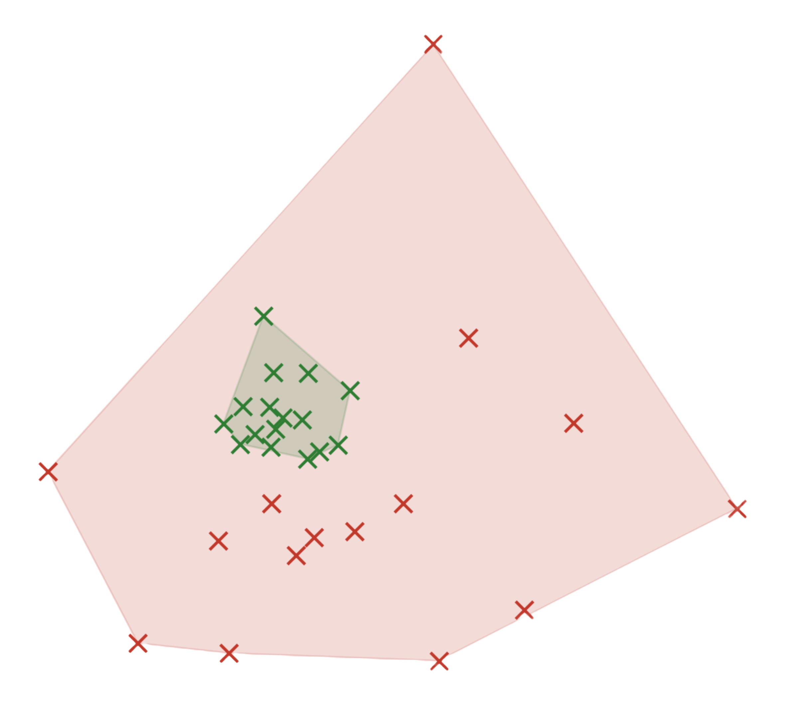

<p align="center">
  
</p>

# <div align="center">ROAM-GRPO</div>

Code for ROAM-GRPO (Routed Off-mode Approach Mining for GRPO).

## Repo Structure

```
ROAM-GRPO/
├── roam/                          # Core algorithm
│   ├── train.py                   # GRPO + ROAM training script
│   ├── routed_offmode.py           # ROAM loss, routing, off-mode mining, self-distillation
│   ├── distinctness_prompt.py      # LLM judge prompt (distinctness scoring)
│   ├── validity_prompt.py         # LLM judge prompt (reasoning-soundness)
│   ├── run_grpo.sh                # Training launch script
│   ├── judge_watchdog.sh          # Keeps the off-mode judge server healthy (recycle/restart)
│   ├── supervise.sh               # Detects stalled/crashed vllm and restarts from latest checkpoint
│   └── trl_timeout_patch.py       # Timeout patch for TRL training loop
├── eval/                          # Evaluation
│   ├── passk_eval.py              # pass@k evaluation with vLLM serving
│   ├── vllm_serve_lora.py         # vLLM server with LoRA hot-loading
│   └── recompute_diversity.py     # Embedding/diversity computation offline
├── figures/                       # Paper figure scripts
│   ├── curves_r1.py               # Training-curve figure (pass@1/16, dispersion)
│   ├── fig_exemplar.py            # Per-problem exemplars
│   └── fig_embedding.py           # Single-problem solution-embedding diagram
├── example_completions/           # Completions used for diagrams in paper
└── data/                          # Datasets
    ├── math_train_l5_sub1000.jsonl     # Training set: 1000 MATH Level-5 problems
    ├── math_eval.jsonl                 # Eval set: 400 MATH Level-5 test problems
    └── omnimath_eval.jsonl             # Eval set: 400 Omni-MATH L5/6 problems
```

## Setup

### Requirements
- Python 3.10+
- PyTorch 2.x with CUDA
- transformers >= 4.57
- trl >= 1.4.0
- vllm >= 0.19.1
- sentence-transformers (for Qwen3-Embedding-0.6B)
- For figure scripts: matplotlib, numpy, scikit-learn, scipy

### Models
- **Trained model:** Qwen3.5-2B with LoRA adapters (r=8, alpha=16, all linear projections)
- **LLM judge:** Qwen3.5-9B (scores off-mode candidates for distinctness and reasoning validity)
- **Embedder:** Qwen3-Embedding-0.6B (for solution dispersion metric)

## Training

`run_grpo.sh` starts the policy generation server and runs the trainer on a single training GPU.
By default it runs plain GRPO (the control); off-mode routing (ROAM) is turned on with the
`--route_*` flags, which additionally require a judge model served separately.

Plain GRPO (control):

```bash
cd roam/
bash run_grpo.sh --run_name grpo --no_wandb
```

GRPO + ROAM: start a judge server (any vLLM server exposing `/generate/`), then launch training
pointed at it:

```bash
cd roam/
# judge (Qwen3.5-9B) on its own GPU, port 8265
CUDA_VISIBLE_DEVICES=3 python -m trl.scripts.vllm_serve \
    --model Qwen/Qwen3.5-9B --host 127.0.0.1 --port 8265 \
    --gpu_memory_utilization 0.6 --max_model_len 4096 --enforce_eager True &

bash run_grpo.sh --run_name roam \
    --route_criterion all_correct --route_lambda 0.2 --route_n_cand 16 \
    --route_judge_url http://localhost:8265 --route_require_validity 1 --no_wandb
```

GPU placement is env-overridable: `GEN_GPU` (generation server), `TRAIN_GPU` (trainer), and
`POLICY_MODEL` (default `Qwen/Qwen3.5-2B`). Add `--init_adapter <path>` to continue from an
existing LoRA adapter.

### Server hygiene (long runs)

vLLM servers can wedge or slowly degrade over long runs. Two optional helpers are useful for keeping long runs alive:

```bash
cd roam/
# Judge: start it and keep it healthy (restart on wedge, ~3h proactive recycle).
# This can replace the manual judge launch above.
JUDGE_GPU=3 JUDGE_PORT=8265 bash judge_watchdog.sh &

# Trainer: run under a supervisor that detects a frozen or crashed run and restarts from latest
# checkpoint (same env/args as run_grpo.sh; a --run_name is required). Writes runs/_logs/HEALTH.txt.
GEN_GPU=1 TRAIN_GPU=0 bash supervise.sh --run_name roam \
    --route_criterion all_correct --route_lambda 0.2 --route_n_cand 16 \
    --route_judge_url http://localhost:8265 --route_require_validity 1 --no_wandb
```

Stop either with `touch runs/_logs/JUDGE_WD_STOP` / `runs/_logs/SUPERVISE_STOP`.

## Evaluation

### pass@k + Diversity

```bash
cd eval/
python passk_eval.py \
    --adapters "grpo_g5000=path/to/adapter,roam_g5000=path/to/adapter" \
    --k 16 --k_list 1,4,8,16 \
    --heldout ../data/math_eval.jsonl \
    --base_model Qwen/Qwen3.5-2B \
    --gpu 0
```

## Figures

Single-problem solution-embedding diagram (per-arm convex hulls, solid = correct / faded =
incorrect), generated directly from a completions file such as those in `example_completions/`:

```bash
cd figures/
python fig_embedding.py --completions ../example_completions/Omni_99.json --out omni_99.png
```


